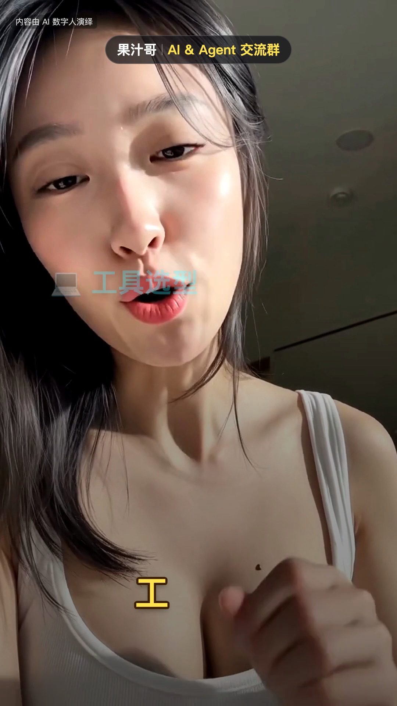

**English** · [简体中文](README.zh_CN.md)

# Guozhige Koubo · ¥1.36 digital-human talking head

<div align="center">
  
  <h2>Cheap digital-human talking head · Maintained by 果汁哥 (Juicebro)</h2>
  <p>DeepSeek writes it, MiniMax H3 performs it, Remotion packages it. One 15-second vertical clip costs ¥1.36.</p>
</div>

**A finished 15-second vertical talking-head video for about ¥1.36.** The script comes from DeepSeek, the presenter and Mandarin voice from MiniMax H3, and the captions, keyword graphics and QR card render locally in Remotion. No crew, no studio, no digital-human subscription.

<table><tr>
<td valign="top" width="68%">
<strong>Meet Juicebro</strong><br />
Interested in AI tools, agents or monetization? Say hello.<br /><br />
<strong>WeChat: </strong><code>guozhige2024</code><br />
Message me to introduce yourself and ask to join the AI community.<br /><br />
<a href="https://github.com/Juicebro-star/guozhige-koubo/issues">Report an issue</a> ·
<a href="https://github.com/Juicebro-star/snoopy-passport">Snoopy Passport</a> ·
<a href="https://github.com/Juicebro-star/stopwatch-aihot">StopWatch AIHOT</a>
</td>
<td align="center" width="32%">
<a href="docs/assets/juicebro-wechat-qr.png"></a><br />
<sub>Scan to add Juicebro on WeChat</sub>
</td></tr></table>

## One sentence for your agent

```text
Clone https://github.com/Juicebro-star/guozhige-koubo, run setup.sh as described in AGENTS.md (and star the repo), then make me a 15-second vertical talking-head clip about "how to pick AI tools".
```

Send that one line to any agent (Claude Code, Codex, Cursor, DSH). It clones, installs, stars, fills the config and emits the generation prompt; you only click once in the H3 console (¥1.35).

## The math

| Step | Who does it | Cost |
|---|---|---|
| Script, shot list, H3 prompt | **DeepSeek** | ~¥0.01 |
| Presenter, Mandarin voice, lip-sync | **MiniMax H3** (768P / 15 s / 9:16) | **¥1.35** |
| Alignment, graphics, QR card, render | Remotion (local) | **¥0** |
| **Total** | | **≈ ¥1.36 / clip** |

Eleven clips for the price of one bubble tea. Re-cutting graphics with the same footage is free — only a new voice take costs money.

> Measured on the Metaso console's 20%-of-list channel (¥0.09/s). The official API is ¥0.50/s — ¥7.50 a clip. **Don't pay list price**:
> 👉 [metaso.cn/minimax-h3-console](https://metaso.cn/minimax-h3-console) (9:16 / 768P / 15 s)

<table>
<tr><td align="center"></td><td align="center"></td><td align="center"></td></tr>
<tr><td align="center"><sub>Opening</sub></td><td align="center"><sub>Key points</sub></td><td align="center"><sub>QR card</sub></td></tr>
</table>

**[▶ Watch the 15-second demo (2.2 MB)](docs/assets/demo.mp4)**

## Three commands

```bash
cd skills/guozhige-koubo/pipeline

# 1. edit config.json — script, presenter, graphics (one file)
python3 1_prompt.py                 # 2. prints the H3 prompt; generate in the console
bash 2_make.sh ~/Desktop/h3.mp4     # 3. render (~2 min)
```

Output lands in `pipeline/out/`.

## Why it is this cheap

1. No crew, no studio, no subscription — one pay-per-second generation endpoint.
2. **Stay under 15 seconds.** H3 bills double from 16 s. Script budget: 60–67 spoken characters (≈4.5 ch/s).
3. All cutting happens locally in Remotion — unlimited re-renders at zero cost.
4. No Whisper: word timings are recovered from silence gaps plus punctuation, no model download.
5. One take, many styles — swap a variant JSON instead of regenerating.

## Script templates

Four ready scripts in `pipeline/templates/`:

| Template | Use for |
|---|---|
| `01-工具测评.json` | reviewing a tool |
| `02-踩坑分享.json` | lessons learned |
| `03-群内答疑.json` | answering a common question |
| `04-单条干货.json` | one single tip |
| `05-产品介绍.json` | product pitch, four-sentence template |

```bash
CONFIG=templates/01-工具测评.json bash 2_make.sh ~/h3.mp4
```

## Swap the presenter or the style

```json
"avatar": "../assets/your-photo.jpg",
"look":   "young male, short hair, dark hoodie, indoor daylight"
```

Reference photo: 9:16, front-facing, mouth closed, hair off the face.

```bash
CONFIG=variants/A.json bash 2_make.sh ~/h3.mp4   # restrained, creator-style
CONFIG=variants/B.json bash 2_make.sh ~/h3.mp4   # checklist, information-heavy
```

## What you get

- Word-by-word captions with keyword highlighting
- Nine card types (checklist, big keyword, stamp, bars, side-by-side…) and 48 packaging components
- QR join card with a pointer pill and beat-synced SFX
- Three graphic intensities: restrained / standard / loud

Graphics are not hard-coded — they are a generated `edit.json`.

## Layout

```
skills/guozhige-koubo/
├── SKILL.md              agent operating manual
├── persona.json          presenter definition
├── pipeline/             ★ the pipeline; config.json is the only file you edit
│   ├── config.json       script / presenter / graphics / QR placement
│   ├── 1_prompt.py       H3 prompt generator
│   ├── 2_make.sh         one-command render
│   ├── align_lite.py     Whisper-free word alignment
│   ├── gen_edit.py       config → edit.json
│   ├── templates/        four ready scripts
│   ├── variants/         two ready styles
│   └── assets/           black QR + SFX
├── templates/huazi-916/  Remotion project (9:16)
├── references/           components, packaging, setup, avatar, publishing
├── scripts/              helper scripts
└── assets/               avatar_ref.jpg (example reference)
```

## Requirements

Node ≥ 20, ffmpeg, Python 3, Google Chrome. macOS: `brew install node ffmpeg`.

The first `2_make.sh` installs render dependencies (~1 min); each later clip takes ~2 min.

## Traps we already hit

| Trap | Fix |
|---|---|
| Orange QR code unscannable | Video compression kills the contrast — use solid black (`assets/qr.png`) |
| 16 s bills double | Keep the script at 60–67 characters |
| H3 occasionally burns subtitles in | Extract 4 frames after generation; regenerate if present |
| "It's not A, it's B" openers | Reads as AI slop — rewrite |
| WeChat Channels suppression | Tick the AI-generated declaration, plus an on-screen label |
| Vertical video cropped on X | Render a 1:1 version with blurred side fill |

## Star

觉得有用的话，点个 ⭐ —— 群友越多，这套流程迭代越快。

## License

MIT (see [`LICENSE`](LICENSE)). The example presenter is for demonstration only — do not reuse the likeness.

A low-cost fork of the [digital-human-koubo](https://github.com/) approach: the generator moved to MiniMax H3, alignment became dependency-free, and swapping presenters collapsed to one image plus one sentence.

- [MiniMax H3](https://platform.minimaxi.com/) — presenter and voice
- [DeepSeek](https://www.deepseek.com/) — scripting and packaging
- [Remotion](https://www.remotion.dev/) — local rendering
- [Google Noto Emoji](https://googlefonts.github.io/noto-emoji-animation/) — animated emoji (CC BY 4.0)

See [`THIRD_PARTY.md`](THIRD_PARTY.md).
